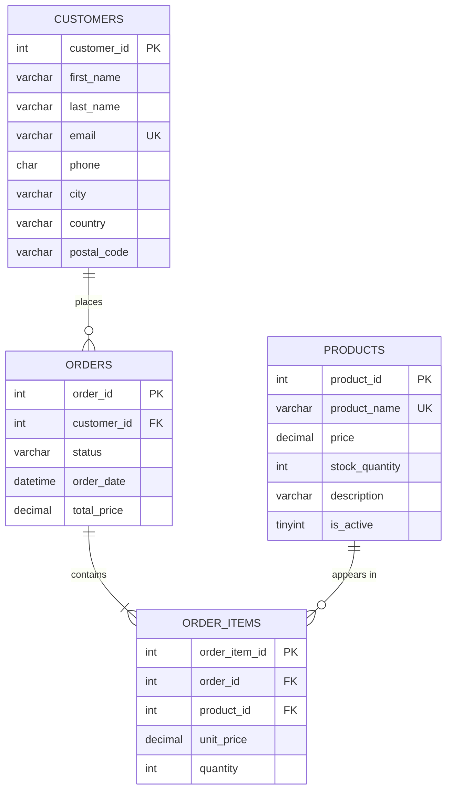

# Simple Store Management System

A small command-line store management app built with **Python** and **MySQL**.
It manages customers, products and orders, and is structured as a layered backend (interface → service → repository → database).

This is an educational project. The goal is to practice database design, clean layering, input validation and transactional logic, not to be a production store.

**Highlights**
- Layered architecture: interface → service → repository → MySQL
- Atomic order creation (order + items + stock update in one transaction)
- Price snapshot per order item, so old orders never change when prices change
- Soft deactivation of products and protected deletion of customers to keep history intact

## Features

**Customers**
- Create, search (by ID or email), list, update and delete
- Email must be unique (checked in Python and enforced by MySQL)
- A customer who has orders cannot be deleted

**Products**
- Create, search (by ID or name), list, view description, update (name, price, description)
- Add stock
- Activate / deactivate instead of deleting, so order history stays intact

**Orders**
- Create an order with multiple products in one flow (review and confirm before saving)
- Duplicate products in one order are merged into a single item
- `unit_price` is stored per order item as a price snapshot, so later price changes don't affect old orders
- View orders by order ID or customer ID, view order items, and view a full order with its items

## Tech Stack

- Python 3.13
- MySQL 8.0+
- `mysql-connector-python`
- `python-dotenv`

## Prerequisites

- Python 3.13 (tested with 3.13.2): https://www.python.org/downloads/
- MySQL Server 8.0 or newer: https://dev.mysql.com/downloads/mysql/
- Git

Check your installation:

```bash
python --version      # on Linux/macOS you may need: python3 --version
mysql --version
```

On Windows, make sure **Add Python to PATH** is checked during the Python installation.

## Getting Started

### 1. Clone

```bash
git clone https://github.com/Mhdi-abdi/simple-store-management-system.git
cd simple-store-management-system
```

### 2. Create a virtual environment and install dependencies

```bash
python -m venv venv
source venv/bin/activate        # Windows: venv\Scripts\activate
pip install -r requirements.txt
```

### 3. Create the database

Run the schema with an administrative MySQL account (for example `root`):

```bash
mysql -u root -p < database/schema.sql
```

> **Linux (Ubuntu/Debian):** the MySQL `root` account often uses socket authentication, so the command above fails with `ERROR 1698 (28000): Access denied for user 'root'@'localhost'`. In that case run it with `sudo` instead (no password is needed):
>
> ```bash
> sudo mysql < database/schema.sql
> ```

### 4. Create a database user for the app

Open the MySQL shell as an administrator and run:

```bash
mysql -u root -p                # Linux (Ubuntu/Debian): sudo mysql
```

```sql
CREATE USER 'store_app'@'localhost' IDENTIFIED BY 'your_password';
GRANT SELECT, INSERT, UPDATE, DELETE ON mystore.* TO 'store_app'@'localhost';
```

You can also skip this step and use another existing MySQL user in `.env`.

### 5. Configure environment variables

Copy `.env.example` to `.env` and fill in your values:

```
DB_HOST=localhost
DB_PORT=3306
DB_NAME=mystore
DB_USER=store_app
DB_PASSWORD=your_password
```

### 6. Run

From the project root:

```bash
python -m src.main
```

## Usage Example

Main menu:

```
--Welcome to my store--

1. Customer
2. Product
3. Order
4. Quit

Please enter one choice (Press Enter to quit):
```

Reviewing and confirming an order (sample data):

```
Customer ID: 1|Customer Name = Ali Ahmadi

Product ID: 2|Product Name: Keyboard|Quantity: 2|Price: 49.99
Product ID: 5|Product Name: Mouse|Quantity: 1|Price: 19.50
Total Price: 119.48

1. Accept Order list
2. Cancel order

Please Enter one choice between(1, 2) (Press Enter to cancel all orders): 1

Order created successfully with ID: 1
```

## Project Structure

```
.
├── database/
│   └── schema.sql              # MySQL schema (tables, keys, constraints)
├── src/
│   ├── main.py                 # Entry point (main menu)
│   ├── exceptions.py           # AppError, ValidationError, NotFoundError, ...
│   ├── database/
│   │   └── connection.py       # MySQL connection from .env
│   ├── model/                  # Plain classes: Customer, Product, Order, OrderItem
│   ├── repository/             # SQL only (parameterized queries)
│   ├── service/                # Validation and business rules
│   └── interface/              # CLI menus and printing
├── .env.example
├── requirements.txt
└── LICENSE
```

**Layers**

```
Interface (CLI)  →  Service (rules, validation)  →  Repository (SQL)  →  MySQL
                              ↑
                        Models / Exceptions
```

## Database Design



| Table | Key points |
|---|---|
| `customers` | `email` UNIQUE |
| `products` | `product_name` UNIQUE, `CHECK (price > 0)`, `CHECK (stock_quantity >= 0)`, `is_active` flag |
| `orders` | `customer_id` FK with `ON DELETE RESTRICT`, `status` (default `registered`), `total_price` |
| `order_items` | FK to `orders` (`ON DELETE CASCADE`) and `products` (`ON DELETE RESTRICT`), `CHECK (unit_price > 0)`, `CHECK (quantity > 0)` |

Design decisions:
- Products are never deleted; they are deactivated.
- Customers with orders cannot be deleted (`RESTRICT`).
- Order items hold the price at order time (snapshot).

## Order Creation and Transactions

Creating an order is one atomic operation. A single connection and cursor is shared by the order, order items and stock update, and everything is committed together or rolled back together:

1. Validate the customer, the products (exist, active) and the quantities
2. Insert the order
3. Insert all order items
4. Reduce stock with a guarded update (`WHERE stock_quantity >= quantity`), so the stock is re-checked inside the transaction and can never go negative
5. `COMMIT`, or `ROLLBACK` on any error

Stock updates are applied in sorted `product_id` order to reduce the chance of deadlocks between concurrent orders.

## Error Handling

All expected errors derive from `AppError`:

- `ValidationError`: invalid input
- `NotFoundError`: record does not exist
- `DuplicateError`: unique value already exists
- `InsufficientStockError`: not enough stock

The interface layer catches these and prints a friendly message. Database errors are caught in `main.py`.

## Current Limitations

- No order payment, cancellation or status flow yet. Orders are created with status `registered`, and stock is currently reduced when the order is created.
- No automated tests yet.
- No authentication; this is a local CLI tool.

## Roadmap

- [ ] Payment flow: `registered` → `paid`, with stock reduced only after successful payment
- [ ] Order cancellation
- [ ] Unit and integration tests
- [ ] REST API
- [ ] Docker setup

## Author

Mhdi Abdi: [GitHub](https://github.com/Mhdi-abdi)

## License

MIT, see [LICENSE](LICENSE).